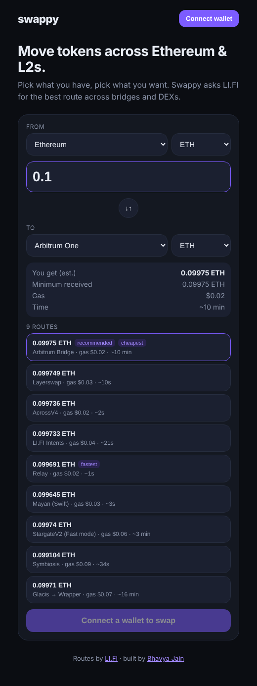

# Swappy

Swap and bridge tokens across **Ethereum, Arbitrum, Optimism, Base and Polygon** from one screen.
Swappy asks [LI.FI](https://li.fi) for routes across bridges and DEXs, shows you the options, and executes the one you pick from your own wallet.



## What it does

- Pick a source chain + token and a destination chain + token
- Fetches live routes from LI.FI (Across, Relay, Stargate, native bridges, DEX aggregators…)
- Shows estimated output, minimum received, gas cost and time for each route
- Executes the route with your wallet: approvals, swaps, bridging and chain switching are handled by the LI.FI SDK
- Live step-by-step progress with explorer links

Same-chain swaps work too (e.g. ETH → USDC on Base).

## Stack

- [Next.js](https://nextjs.org) (App Router) + TypeScript
- [wagmi](https://wagmi.sh) + [viem](https://viem.sh) for wallet connection
- [@lifi/sdk](https://docs.li.fi/sdk/overview) + `@lifi/sdk-provider-ethereum` for routing and execution
- TanStack Query for data fetching

## Run locally

```bash
git clone https://github.com/notbhavyajain/Swappy.git
cd Swappy
npm install
npm run dev
```

Open http://localhost:3000 and connect a browser wallet (MetaMask, Rabby, etc.).

Optional: copy `.env.example` to `.env.local` and add your own RPC URLs. Public RPCs are used otherwise.

## How it works

```
src/
├─ app/                 # Next.js app router (layout, page, providers)
├─ components/
│  ├─ SwapCard.tsx      # main form: tokens, amount, routes, execute
│  ├─ RouteList.tsx     # route options from LI.FI
│  ├─ ExecutionStatus.tsx
│  ├─ TokenPicker.tsx
│  └─ WalletButton.tsx
└─ lib/
   ├─ lifi.ts           # LI.FI client wired to the wagmi wallet
   ├─ wagmi.ts          # chains + injected connector
   ├─ useTokens.ts      # featured tokens per chain from LI.FI
   └─ chains.ts, format.ts
```

1. `getTokens` loads tokens for the supported chains and keeps the common ones (ETH, WETH, USDC, USDT, DAI, WBTC, POL).
2. `getRoutes` returns route options for the chosen pair and amount (refreshed every 30s).
3. `executeRoute` runs the selected route. The LI.FI EVM provider uses wagmi's `getConnectorClient` / `switchChain`, so your own wallet signs every step.

## Notes

- This is a learning project. Start with small amounts.
- Default slippage is 0.5%.

## License

MIT
